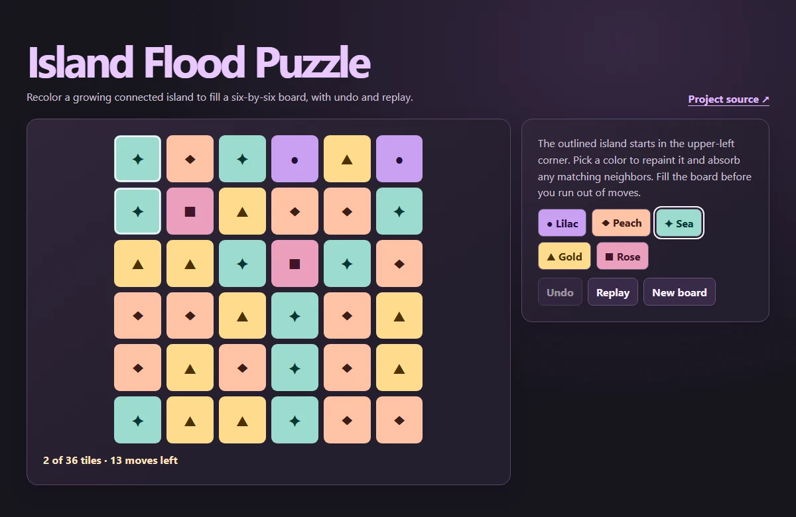

# Island Flood Puzzle

Recolor a growing connected island to fill a six-by-six board, with undo and replay.

[Open the browser app](https://surfingcoder.com/apps/island-flood-puzzle/)

## Run locally

Run the following command in this repository and open [localhost:8000](http://localhost:8000).

    python -m http.server 8000

A color change counts as a move. Horizontal and vertical neighbors connect. Every board receives a move budget based on a greedy solution. Undo restores the previous board and move.

## Verify

Run the following command with Node.js 22 or newer.

    node --test
